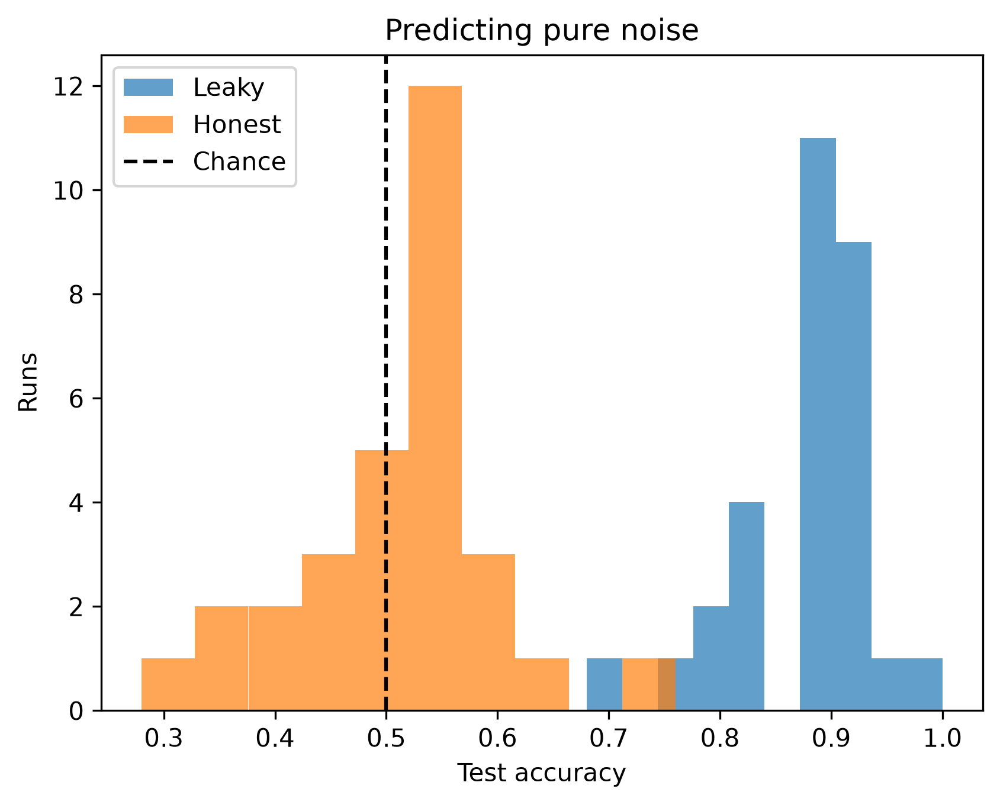

# Data Leakage Demo

Predicting pure random noise with ~88% accuracy by doing feature
selection before the train/test split.

| Pipeline | Avg test accuracy (30 seeds) |
|---|---|
| Leaky (select features, then split) | 87.7% |
| Honest (split, then select) | 50.5% |

The data and labels are random, so honest accuracy should be about 50%.
Selecting features on all the data lets the test labels leak into
training, so the model looks good while learning nothing.

Using a scikit-learn Pipeline prevents this, because feature selection
is fitted inside each fold (5-fold CV: 48%).

Notebook: [data_leakage_demo.ipynb](data_leakage_demo.ipynb)
